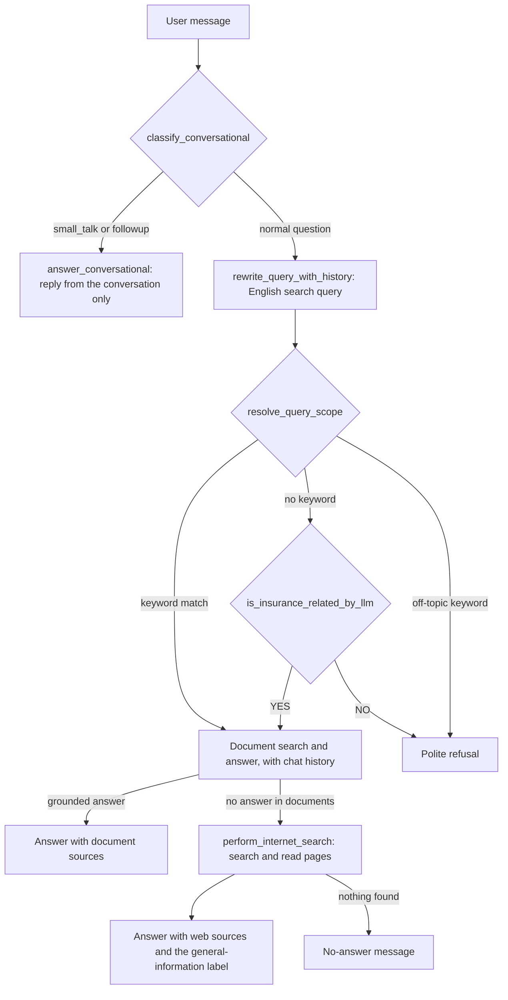

# Chatbot Improvements: Conversation, Relaxed Guardrails, and Automatic Web Search

## Purpose

This document explains how CoverIndex AI changed from a strict question-and-answer tool into a conversational insurance chatbot. It covers the problems, the causes, the design decisions, the code changes, and the tests.

## The Problems

Users reported that the bot "gets stuck" on normal chat messages. Live requests against the server showed these results:

| Message | Old result |
|---|---|
| "now give me the answer of the above question in english" | An unrelated answer from a new document search |
| "translate your last answer to english" | The refusal message |
| "make it shorter" | An unrelated answer about claim documents |
| "hello" | The refusal message |
| "thanks, that helped" | A numbered list with 5 points |
| "my flight got delayed by 8 hours, will I get money back" | The refusal message |
| "what is the average claim settlement ratio of LIC in 2025" | A question: "Do you want me to search the internet?" |

## The Causes

1. **The answering LLM did not see the conversation.** `answer_query()` called `call_groq_rag()` without `chat_history`. Only the query-rewrite step saw the history. Thus the LLM did not know what "the above question" or "your last answer" meant.
2. **Every message went through document search.** A request such as "make it shorter" started a new search, and the LLM answered the search results, not the request.
3. **The scope check used English keywords only.** `classify_query_scope()` refused any message without a word such as "policy" or "claim". A greeting failed this check. A real insurance situation ("my flight got delayed") also failed it.
4. **The prompt forced rigid templates.** The system prompt required "exactly 5 to 7 numbered points" for every response, even for "thanks".
5. **The web search needed permission and returned little.** The bot asked for permission before each search. The search used only three short snippets (about 200 characters each) and never opened the pages.

## Decisions

The project owner chose three options:

| Question | Decision |
|---|---|
| Scope | **Insurance-first.** Answer insurance questions from the documents and the web. Allow small talk and requests about earlier replies. Decline other topics. |
| Web search | **Automatic.** Search the web without permission when the documents have no answer. Label web information clearly. |
| Search backend | **`ddgs` and page reading.** Keep the free `ddgs` package, but download the result pages and extract their text. |

## How Web Search Works

A chatbot does not crawl the internet itself. Search engines do the crawling: their crawlers download pages, follow links, and build an index. A chatbot uses that index through three steps. This pattern is called "web RAG" (retrieval-augmented generation).

1. **Search.** Send the query to a search engine. Get a list of results: a title, a URL, and a short snippet for each result.
2. **Read.** Download the top pages. Remove the page chrome (menus, scripts, footers). Keep the passages that relate to the question.
3. **Answer.** Give those passages to the LLM, with their URLs. The LLM writes an answer and cites the URLs, as it does with the policy PDFs.

The old code did step 1 only. The new code does all three steps.

`ddgs` does not use an API key. It scrapes the result pages of search engines, so an engine can block it without warning. During this work, DuckDuckGo, Brave, Google, and Mojeek all returned "No results found" for every query. Yahoo, Bing, and Yandex returned results. Thus the code now tries several engines in order.

## The New Request Flow



## Changes

### 1. Conversational messages (`policy_rag/agent.py`)

`classify_conversational(query, chat_history)` sorts a message into one of three groups:

- **`small_talk`:** a greeting or thanks, followed only by filler words. Examples: "hello", "thanks, that helped", "नमस्ते", "धन्यवाद". A greeting that is followed by a question ("hi, what is the waiting period?") is not small talk.
- **`followup`:** a request that acts on an earlier reply. Examples: "translate", "shorter", "in English", "the above question", "in simple words", "as a table", "इंग्रजी". This group requires an earlier assistant reply in the history.
- **`None`:** a normal question. It goes through the full pipeline.

The check uses word lists and regular expressions. It does not call an LLM, so it costs nothing and gives the same result every time.

`answer_conversational()` sends the conversation to the LLM with a new prompt, `prompts/system_prompt_conversational.md`. The prompt tells the LLM to apply the request to the earlier reply, to add no new facts, and to keep the "Sources:" list. If the LLM is not available, a greeting gets a stored reply (`GREETING_MESSAGE`) in the user's language.

In `policy_rag/server.py`, a conversational message skips the query rewrite and the document search. The response has `"assistant_mode": "conversational"`. The frontend shows no grounding footer for these replies.

### 2. Chat history for the answering LLM (`policy_rag/agent.py`)

- `answer_query()` now sends `chat_history` to `call_groq_rag()` and `call_gemini_rag()`.
- `call_gemini_rag()` now joins the whole conversation into its prompt through `_flatten_messages()`. Before this change, it sent only the system prompt and the last message.
- The insurance prompt now says that earlier messages are included, and that the LLM must use them to understand follow-up questions.

### 3. Scope check with an LLM second opinion (`policy_rag/agent.py`)

`resolve_query_scope()` runs the old keyword check first:

- A message with an insurance keyword is in scope.
- A message with an off-topic keyword (for example "python" or "recipe") is refused. No LLM call is made.
- A message with no keyword in either list goes to `is_insurance_related_by_llm()`. This function asks the LLM a YES/NO question: is the message about insurance, or about a situation that insurance commonly covers (health costs, accidents, travel delays, lost baggage, theft, and similar)?

A fixed threshold on the document-search score was tested first and rejected. Off-topic questions scored up to 15.6, real travel questions scored 21 to 27, and BM25 scores change with query length. Thus a fixed threshold is not reliable.

### 4. Relaxed templates (`prompts/`)

- `system_prompt_insurance_rag.md` and `system_prompt_fallback_confirmed.md` now use the templates for detailed answers only. A short question gets a short answer. A format request ("as a table", "shorter") is followed.
- "Exactly 5 to 7 numbered points" became "3 to 7 numbered points".
- The fallback prompt now declines non-insurance topics, which matches the insurance-first decision.

### 5. Automatic web search (`policy_rag/agent.py`, `policy_rag/config.py`)

- `REQUIRE_FALLBACK_CONFIRMATION` now defaults to `false`. When the documents have no answer, `answer_query()` calls itself again in `fallback_confirmed` mode, and that mode searches the web.
- The web search uses the English search query, not the original query.
- If the web search finds nothing, the bot says so (`NO_ANSWER_MESSAGE`). It does not show a sources list in that case.
- The label "This is general information and not based on your uploaded policy documents:" is now added by the code, in the user's language. The prompt tells the LLM not to write it, so the label never appears twice.
- To restore the old "Do you want me to search the internet?" question, set `REQUIRE_FALLBACK_CONFIRMATION=true` in `.env`.

### 6. Page reading (`policy_rag/web.py`, new file)

| Function | What it does |
|---|---|
| `perform_internet_search()` (in `agent.py`) | Tries the engines in `WEB_SEARCH_BACKENDS` (default `yahoo,bing,yandex,duckduckgo`) until one returns results. |
| `read_pages()` | Downloads the result pages in parallel. If a page cannot be read, it uses the search snippet. |
| `fetch_page_text()` | Downloads one page. Limits: 6 seconds, 1.5 MB, HTML only. |
| `extract_text_blocks()` | Removes scripts, styles, menus, headers, footers, and forms. Keeps text blocks of 60 characters or more. |
| `select_relevant_text()` | Keeps the blocks that share the most words with the query, up to 1,500 characters per page. |
| `is_public_http_url()` | Accepts only `http` and `https` URLs whose host resolves to a public address. |

The code uses only the Python standard library, so no new dependency was added.

### 7. Speed fix for the Gemini fallback

A live test of the LIC question took 451 seconds. The timing showed the cause:

- Groq answered `[NO_CONTEXT]` in 0.8 seconds. This means "the documents do not answer this".
- The code treated that answer as a failure and sent the same question to Gemini.
- Gemini returned "high demand" (HTTP 503) errors. Its SDK retried them for 443 seconds.

Two changes fixed this:

1. A `[NO_CONTEXT]` answer from Groq now skips Gemini. Gemini is called only when Groq fails.
2. All Gemini calls use `_gemini_client()`, with a 20-second timeout and no SDK retries. The legacy `google.generativeai` calls also have a 20-second timeout.

After the fix, the same question took 9 seconds.

### 8. Hindi or Marathi detection (`policy_rag/utils.py`)

`guess_devanagari_language()` tells Hindi from Marathi by common words (for example आहे, नाही, आणि for Marathi and है, नहीं, और for Hindi) and by the letter ळ, which is frequent only in Marathi. `translate_to_user_language()` uses it, so the stored translations of the fixed messages work for Marathi without an LLM call.

## Safety Measures

- **Internal addresses.** The server never downloads a page whose host resolves to a private, loopback, or link-local address. It checks the final address after redirects too. This prevents a search result from making the server read internal services.
- **Prompt injection.** The fallback prompt tells the LLM to treat web text as untrusted reference text and to ignore instructions inside it.
- **Invented figures.** In one test, the web search returned nothing and the LLM stated LIC figures from memory. The fallback prompt now forbids numbers, percentages, dates, and company figures that are not in the sources.
- **Clear labels.** Web answers carry the general-information label and list their URLs as sources.

## Configuration

| Variable | Default | Effect |
|---|---|---|
| `REQUIRE_FALLBACK_CONFIRMATION` | `false` | `true` asks the user before each web search. |
| `WEB_SEARCH_BACKENDS` | `yahoo,bing,yandex,duckduckgo` | Search engines that `ddgs` tries, in order. |
| `GEMINI_MODEL` | `gemini-3.8-flash` | Gemini model for the fallback. |

## Tests

The new tests are in `tests/test_chatbot.py`. All external calls (LLMs, web search, page downloads) are mocked.

| Area | What the tests check |
|---|---|
| Conversation classifier | Greetings and thanks in several languages are small talk. A greeting with a question is not. Follow-up requests need an earlier reply. |
| Conversational endpoint | A follow-up skips the rewrite and the document search, and the LLM receives the full history. A greeting works without an LLM. |
| Scope | The LLM check widens the scope when no keyword matches. Off-topic keywords skip the LLM. |
| Web search | The bot searches automatically and labels the answer. A failed search gives the no-answer message without sources. The search tries the next engine after a failure. |
| Gemini | A `[NO_CONTEXT]` answer from Groq does not call Gemini. |
| Chat history | The answering LLM receives the conversation. |
| Page reading | Page chrome is removed. Relevant blocks are selected. Internal and non-HTTP URLs are rejected. An unreadable page falls back to its snippet. |
| Languages | Hindi and Marathi sentences are told apart. |

Results:

- `tests/test_chatbot.py` and `tests/test_multilingual.py`: 40 tests pass.
- `tests/test_prompt_guardrails.py`: the same 11 failures as before this work. These tests expect old prompt text. One test in this file was updated, because the default of `REQUIRE_FALLBACK_CONFIRMATION` changed on purpose.

To run the tests:

```
uv run python -m unittest tests.test_chatbot tests.test_multilingual -v
```

## Live Results

These requests were sent to the running server after the changes:

| Message | New result |
|---|---|
| "now give me the answer of the above question in english" | The earlier Marathi answer in English, with its sources |
| "make it shorter" | A shorter form of the earlier answer |
| "hello" | "Hello! How can I help you with your insurance policies, claims, or coverage today?" |
| "thanks, that helped" | A short reply that offers more help |
| "my flight got delayed by 8 hours, will I get money back" | An answer from the Tata AIG travel policy, with sources |
| "what is the capital of France" | The polite refusal |
| "what is the average claim settlement ratio of LIC in 2025" | An answer from three web pages, with links and the general-information label, in 9 seconds |

## Known Limits

- **`ddgs` scraping can stop working at any time.** DuckDuckGo has no official search API and no API key. For a stable search, replace `ddgs` in `perform_internet_search()` with a keyed search API, for example Brave Search API, Tavily, or Serper.
- **The follow-up word lists are not complete.** A follow-up request that uses other words goes through the normal pipeline. It still works in most cases, because the answering LLM now sees the chat history.
- **The scope check costs one LLM call** for each message that has no keyword in either list.
- **Web answers depend on the quality of the pages found.** The bot cites the pages, but it does not check that they are correct.
- **A follow-up keeps the earlier reply's language** unless the user asks for another language. For example, "make it shorter" after a Marathi answer gives a shorter Marathi answer.
